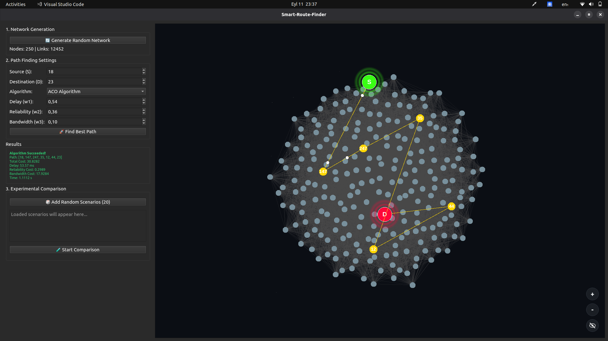
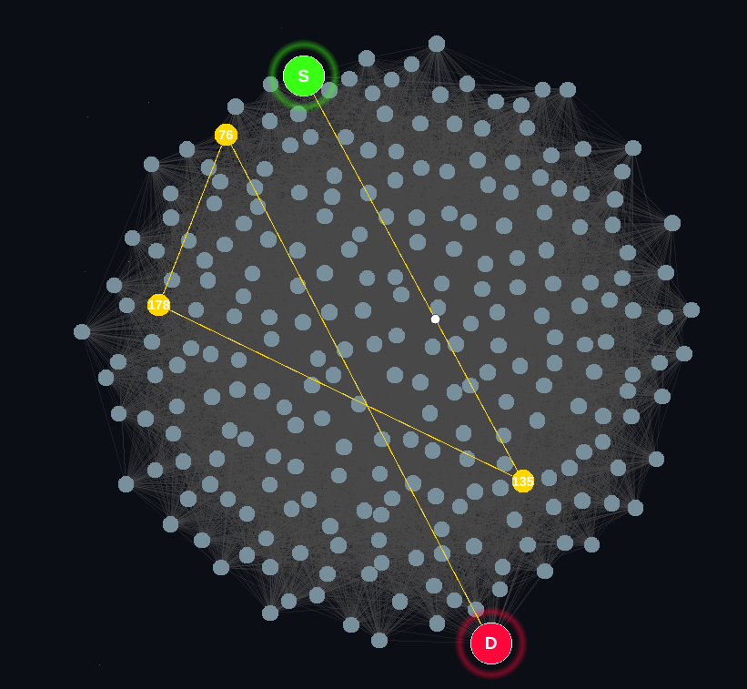
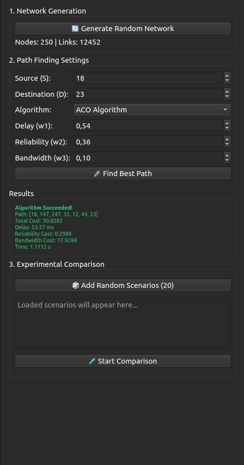

# Smart Route Finder (Akıllı Rota Bulucu)

This project was developed to solve the **smart route finding** problem on network (graph) structures. The goal is to find the most optimal route using different algorithms (Genetic Algorithm, ACO, Q-Learning, etc.) and to visualize the results through a **graphical user interface (UI)**.

The project is organized into an algorithm layer, a data generation/processing layer, and a user interface layer.

---

## 🎬 Preview


*Demo of the app in action (autoplays and loops on GitHub).*

---

## 🖥️ Interface



*Whole interface section: network graph (right) and controls (left).*

---

## 🕸️ Network Graph



*Closer view of the network graph: source (S), destination (D), and the best path found.*

---

## 🎛️ Control Panel



*Controls section only: network generation, path finding settings, results, and experimental comparison.*

---

## 📁 Project Folder Structure

```
akilli-rota-bulucu/
│
├── Arayuz/                 # Graphical user interface (UI) ("Arayuz" = "Interface" in Turkish)
│   ├── main.py             # Main entry point that launches the application
│   ├── ui/                 # UI components
│   └── resources/          # Images and static files
│
├── ACO_Algorithm.py        # Ant Colony Optimization algorithm
├── GeneticAlgorithm.py     # Genetic Algorithm
├── QLearning.py            # Q-Learning algorithm
├── Metrics.py              # Performance metrics
├── generate_graf.py        # Graph generation ("graf" = "graph")
├── path_utilities.py       # Path / route helper functions
│
├── data/                   # Data files (CSV, etc.)
├── assets/                 # README visuals (demo GIF + screenshots)
│   ├── demo-preview.gif    # Autoplaying app demo (preview)
│   ├── app-interface.png   # Full interface (graph + controls)
│   ├── network-graph.png   # Close-up of the network graph
│   └── control-panel.png   # Controls section only
│
├── requirements.txt        # Python dependencies
└── README.md               # Project documentation
```

---

## ⚙️ Requirements

* Python **3.9+** (recommended)
* Required Python libraries (listed in requirements.txt)

---

## 📦 Installation

1️⃣ Clone the repo:

```bash
git clone https://github.com/HusseinAbdow/akilli-rota-bulucu.git
cd akilli-rota-bulucu
```

2️⃣ (Recommended) Create a virtual environment:

```bash
python -m venv venv

# Linux / macOS
source venv/bin/activate

# Windows
venv\Scripts\activate
```

3️⃣ Install the required packages:

```bash
pip install -r requirements.txt
```

---

## ▶️ Running the Application

The **main entry point** of the application is:

```
Arayuz/main.py
```

To run it:

```bash
python Arayuz/main.py
```

This command launches the graphical interface and lets you use the route-finding algorithms through the UI.

---

## 🧠 Algorithms Used

* **Genetic Algorithm** – Evolutionary optimization
* **Ant Colony Optimization (ACO)** – Ant-colony-based route finding
* **Q-Learning** – Reinforcement learning approach

The algorithms live in the root directory and are called by the UI.

---

## 🧪 Development Notes

* `__pycache__/` folders should not be included in GitHub
* Preserve the root directory structure when adding a new algorithm
* `git reset --hard origin/main` may be required after large structural changes

---

## 📄 License

This project is for educational purposes. License information will be added later.

---

## ✍️ Note

This README was prepared to simplify the project structure and focus on UI-centered usage. Old folder structures are no longer valid.
